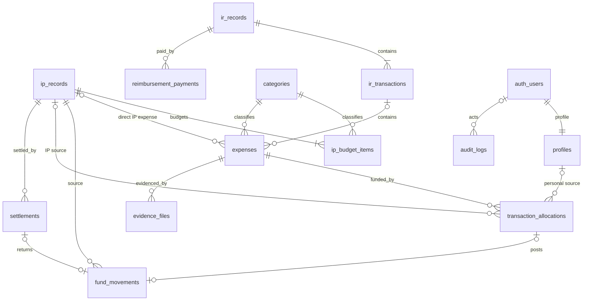

# FAAMS — Finance Administration & Accountability Management System

Fondasi aplikasi administrasi keuangan internal, dibangun bertahap berdasarkan
Part. Part 01 menyiapkan project, autentikasi, layout dashboard, navigasi, dan
database foundation. Part 02 menambahkan finance schema dan master data; Part 03
dan Part 04 menambahkan workflow Internal Prepayment serta Internal
Reimbursement. Part 05 menambahkan evidence management dan Part 06 menambahkan
transaction ledger serta balance reconciliation.

## Struktur project

```text
src/
  app/
    (app)/                 # Dashboard dan halaman aplikasi yang diproteksi
      evidence-center/     # Pencarian, preview, dan download bukti
      transaction-ledger/  # Ledger arus kas IP dan Personal
      reconciliation/      # Snapshot saldo, status, dan filter periode
    (auth)/                # Login dan pemulihan password
    auth/callback/         # Callback Supabase Auth
    globals.css
  components/
    auth/                  # Form autentikasi
    evidence/              # Form upload dan pengaitan evidence
    ui/                    # Komponen shadcn/ui
  lib/
    supabase/              # Browser/server clients dan konfigurasi
    navigation.ts
supabase/
  migrations/
  tests/
```

## Dependensi utama

- Next.js 16 App Router, React 19, TypeScript, Tailwind CSS 4.
- shadcn/ui (Base UI primitives), Lucide React, Sonner, Zod.
- Supabase JS v2 dan `@supabase/ssr`.

Versi tepat dan transitive dependencies tercatat di `package-lock.json`.

## Persiapan Supabase

1. Buat project Supabase dan siapkan database PostgreSQL.
2. Jalankan migration yang tersedia secara berurutan menggunakan Supabase CLI
   (`npx supabase db push` untuk project hosted). Jika memakai SQL Editor,
   jalankan kedua file di `supabase/migrations/` berdasarkan urutan timestamp.
3. Aktifkan provider Email di **Authentication → Providers**. Buat akun
   administrator melalui **Authentication → Users**; jangan membuka signup
   publik. Administrator dapat mengundang akun pemohon melalui menu Settings.
4. Promosikan hanya akun tersebut menjadi administrator di SQL Editor dengan
   mengganti UUID berikut:

   ```sql
   update public.profiles
   set is_admin = true
   where id = 'UUID-AKUN-ADMIN';
   ```

   Profile dibuat otomatis saat user Supabase dibuat. Jika tidak ada baris
   profile, pastikan migration dan trigger berhasil sebelum mencoba login.
5. Di **Authentication → URL Configuration**, set Site URL ke
   `http://localhost:3000` dan tambahkan redirect URL
   `http://localhost:3000/**`. Untuk deployment, tambahkan domain produksi.
6. Salin `.env.example` menjadi `.env.local`, lalu masukkan Project URL dan
   publishable key dari **Project Settings → API Keys**:

   ```dotenv
   NEXT_PUBLIC_SUPABASE_URL=https://your-project-ref.supabase.co
   NEXT_PUBLIC_SUPABASE_PUBLISHABLE_KEY=your-supabase-publishable-key
   NEXT_PUBLIC_SITE_URL=http://localhost:3000
   ```

   Hanya publishable key yang digunakan aplikasi. Jangan masukkan    `service_role` key ke environment frontend atau commit file `.env.local`. Set nilai ini
   sebelum production build karena variabel `NEXT_PUBLIC_*` dimasukkan ke
   bundle browser saat build.
7. Untuk mengirim undangan dari Settings, tambahkan `SUPABASE_SERVICE_ROLE_KEY`
   hanya ke environment server (lokal `.env.local` atau secret deployment).
   Key ini tidak memakai prefix `NEXT_PUBLIC_` dan tidak boleh dikirim ke
   browser atau dimasukkan ke source control. Jika tidak disetel, admin tetap
   dapat mengundang pengguna melalui Supabase Authentication Dashboard.

## Multi-akun dan profil pemohon

Migration `20261122140000_multi_account_ownership.sql` menambahkan NIK kantor
dan referensi tanda tangan privat ke profil, RLS berbasis pemilik untuk record IP/IR,
serta RPC sumber IP lintas pemilik yang hanya menampilkan nomor, keperluan, dan
saldo tersedia. Terapkan migration ini setelah migration fitur sebelumnya
dengan `npx supabase db push` atau jalankan SQL melalui Supabase SQL Editor.

Administrator mengundang pemohon lewat **Settings → Undang pengguna**. Setelah
login pertama, pemohon wajib melengkapi nama, NIK kantor (maksimal 80 karakter,
bukan NIK KTP), dan tanda tangan. Tanda tangan dapat diunggah sebagai JPG/PNG
atau digambar langsung menggunakan mouse atau layar sentuh. Profil belum lengkap
tidak dapat masuk ke aplikasi. Setiap record IP/IR baru ditautkan ke `auth.uid()`
pembuatnya; pemohon hanya membaca serta melengkapi record miliknya. Admin tetap
menangani persetujuan, pencairan IP, pembayaran reimbursement, dan penutupan.
Pemohon dapat memilih IP mana pun sebagai sumber IR, tetapi hanya informasi
minimum sumber dana yang ditampilkan. Jalankan juga migration
`20261122143000_office_id_and_drawn_signature.sql` setelah migration multi-akun
untuk mengganti kolom `national_id` menjadi `employee_id` dan menerapkan
validasi NIK kantor yang tidak mengasumsikan 16 digit.

Export IP dan IR menggunakan nama, NIK kantor, dan tanda tangan dari profil pemilik
record. Identitas dan tanda tangan penyetuju tetap dikelola administrator pada
Settings. Data yang sudah ada tetap terkait dengan `created_by` yang tersimpan;
pastikan profil admin lama dilengkapi sebelum ekspor dokumen.

Acceptance checklist:

- [ ] Jalankan migration di project Supabase uji dan lengkapi profil admin.
- [ ] Undang pengguna baru, lalu pastikan pengguna wajib mengisi nama, NIK kantor, dan tanda tangan sebelum masuk.
- [ ] Uji tanda tangan dengan unggah JPG/PNG dan dengan menggambar melalui mouse dan layar sentuh.
- [ ] Buat IP/IR dari dua akun; pastikan masing-masing hanya dapat membaca record miliknya.
- [ ] Pastikan akun pemohon tidak dapat menyetujui, mencairkan, membayar reimbursement, atau menutup record.
- [ ] Buat IR dengan alokasi ke IP akun lain; pastikan hanya nomor/keperluan/saldo tersedia yang muncul pada pemilihan sumber.
- [ ] Uji akses silang langsung ke tabel dan Storage signed URL; akses record/evidence milik akun lain harus ditolak, kecuali alur ledger IP yang memang dibagikan untuk audit sumber dana.
- [ ] Export IP dan IR milik kedua akun; pastikan tanda tangan pemohon berasal dari profil pemilik, sedangkan penyetuju dari Settings.
- [ ] Pastikan `SUPABASE_SERVICE_ROLE_KEY` tidak masuk ke bundle browser atau source control.

## Instalasi dan menjalankan

Gunakan Node.js versi 20.9 atau yang lebih baru.

```bash
npm install
npm run dev
```

Buka <http://localhost:3000>. Tanpa konfigurasi Supabase, halaman aplikasi
dilindungi dan login menampilkan petunjuk konfigurasi.

Perintah validasi:

```bash
npm run lint
npm run typecheck
npm run build
```

## Testing checklist Part 01

- [ ] Isi environment Supabase dan jalankan migration.
- [ ] Akun admin yang dibuat di Supabase dapat login; kredensial salah
      menampilkan pesan error.
- [ ] Membuka `/` tanpa sesi diarahkan ke `/login`; setelah login kembali ke
      dashboard.
- [ ] Refresh browser mempertahankan sesi; tombol Keluar mengakhiri sesi.
- [ ] Lupa password mengirim email dan tautan callback membuka form password
      baru (pastikan URL callback diizinkan di Supabase).
- [ ] Seluruh 12 item navigasi membuka halaman yang sesuai dan dapat digunakan
      di desktop maupun viewport mobile.
- [ ] Supabase menolak akses tabel tanpa sesi/admin sesuai RLS; role admin tidak
      dapat diubah lewat update profile biasa.
- [ ] Jalankan `npm run lint`, `npm run typecheck`, dan `npm run build`.

Data statistik dan tabel dashboard dibiarkan kosong sampai modul finansial
memasok data nyata; tidak ada dummy data produksi.

## Part 03 — Internal Prepayment

Migration `20261120120000_internal_prepayment.sql` menambahkan informasi area/PIC,
relasi evidence untuk pencairan dan pengembalian, status verifikasi penggunaan IP,
fungsi pencatatan transaksi yang atomik, dan view `ip_monitoring`.

Jalankan migration setelah migration Part 02:

```bash
npx supabase db push
```

Atau jalankan file migration Part 03 setelah dua migration sebelumnya melalui
SQL Editor. Halaman `/internal-prepayment` menyediakan form pengajuan dan daftar
monitoring; buka nomor IP untuk mencatat pencairan, realisasi, pengembalian, dan
penutupan settlement.

Realisasi yang dinyatakan tidak sesuai disimpan sebagai `pending_review` dan
tidak membuat arus pengeluaran di ledger sampai diverifikasi. Tindakan tindak
lanjut dapat memverifikasi penggunaan atau menghubungkannya ke draft IR.
Settlement hanya dapat ditutup bila saldo ledger nol, semua realisasi memiliki
bukti aktif, tidak ada selisih yang belum ditindaklanjuti, dan bukti pencairan
serta pengembalian tersedia. Bukti file disimpan di private bucket dan dibuka
dengan signed URL berumur 60 detik.

Acceptance test database:

```bash
psql "$DATABASE_URL" -v ON_ERROR_STOP=1 -f supabase/tests/internal_prepayment.sql
```

Test memeriksa nomor IP otomatis, satu pencairan, realisasi penuh, pengembalian
bertahap, selisih yang tidak dihitung sebelum ditindaklanjuti, kalender 10/14
hari kerja, dan penolakan settlement saat saldo negatif. Seluruh fixture
dibatalkan dalam transaksi (`ROLLBACK`); jalankan pada project uji sebelum
menggunakan terhadap project produksi.

Checklist UI:

- [ ] Ajukan IP dengan beberapa item; total harus sama dengan jumlah item dan nomor IP dibuat otomatis.
- [ ] Catat satu pencairan dengan bukti transfer; pencairan kedua ditolak.
- [ ] Catat realisasi sesuai pengajuan dengan bukti nota dan periksa saldo.
- [ ] Catat realisasi tidak sesuai; pastikan tidak masuk hitungan sampai diputuskan.
- [ ] Tindak lanjuti selisih dengan verifikasi atau menghubungkan/membuat draft IR.
- [ ] Catat pengembalian bertahap dengan bukti; nominal melebihi saldo ditolak.
- [ ] Tutup settlement hanya setelah saldo tepat nol dan seluruh bukti tersedia.
- [ ] Periksa target 10 HK dan deadline administrasi 14 HK pada hari libur terdaftar.
- [ ] Jalankan `npm run lint`, `npm run typecheck`, dan `npm run build`.

## Part 04 — Internal Reimbursement

Migration `20261120130000_internal_reimbursement.sql` menambahkan metadata IR,
nomor IR otomatis, transaksi dengan alokasi Personal/IP/Mixed, status workflow
PTJB dan pembayaran terpisah, bukti transfer reimbursement, view monitoring dan
ringkasan pelaporan. Alokasi IP divalidasi terhadap saldo ledger dan mengurangi
saldo IP satu kali; bagian Personal saja yang membentuk piutang reimbursement.

Jalankan migration setelah Part 03:

```bash
npx supabase db push
```

IR Operasional tersedia di `/ir-operasional`; IR Facility Management tersedia
di `/ir-facility-management`. Buat IR terlebih dahulu lalu buka detailnya untuk
menambahkan satu atau beberapa transaksi. Untuk mixed funding, jumlah seluruh
alokasi Personal dan IP wajib sama persis dengan nominal expense. Transaksi
boleh direkam sebelum evidence tersedia, tetapi tidak dapat diajukan sebagai
PTJB sampai setiap transaksi memiliki bukti aktif. Bukti yang terlambat dapat
diunggah dari detail transaksi.

PTJB dan pembayaran reimbursement memiliki status terpisah. PTJB diajukan
setelah data, sumber dana, dan evidence lengkap; tandai disetujui saat proses
PTJB selesai. Catat reimbursement bertahap dengan bukti transfer. IR hanya
dapat ditutup setelah PTJB disetujui dan semua piutang Personal dibayar; IR yang
dananya seluruhnya berasal dari IP tidak memiliki piutang reimbursement.
Ringkasan total IR menghitung nilai transaksi satu kali dan menampilkan porsi
funding secara terpisah.

Acceptance test database:

```bash
psql "$DATABASE_URL" -v ON_ERROR_STOP=1 -f supabase/tests/internal_reimbursement.sql
```

Test memeriksa nomor IR Operasional/Facility, IR dengan beberapa transaksi,
mixed funding, evidence yang belum lengkap, saldo IP yang tidak mencukupi,
alokasi yang tidak sama dengan nilai expense, pemisahan piutang personal/IP,
PTJB, pembayaran bertahap, dan penutupan. Test memakai fixture dalam transaksi
dan melakukan `ROLLBACK`; jalankan pada project uji.

Checklist UI:

- [ ] Buat IR Operasional dan Facility; nomor dan kategori harus sesuai.
- [ ] Tambah satu atau beberapa transaksi dengan sumber Personal, IP, dan Mixed.
- [ ] Pastikan total funding allocation tepat sama dengan nominal; alokasi IP tanpa saldo ditolak.
- [ ] Simpan transaksi tanpa bukti, unggah bukti belakangan, dan periksa status kelengkapan PTJB.
- [ ] Ajukan lalu setujui PTJB; status pembayaran harus tetap terpisah.
- [ ] Catat beberapa pembayaran reimbursement, masing-masing dengan bukti.
- [ ] Pastikan pembayaran tidak melebihi piutang Personal dan sumber dana IP tidak menambah piutang.
- [ ] Tutup hanya setelah PTJB disetujui dan piutang Personal lunas.
- [ ] Pada detail IR Operasional dan Facility, export Excel menghasilkan satu sheet rincian transaksi, sumber dana, serta pembayaran tanpa lampiran file.
- [ ] Export PDF menampilkan rincian, status PTJB/pembayaran, saldo Personal dan IP terpisah, serta menyisipkan nota, bukti transfer, bukti pembayaran, dan dokumen PTJB yang terhubung.
- [ ] Uji IR mixed funding, pembayaran bertahap, beberapa evidence per transaksi, gambar, dan PDF; pastikan file tampil di lampiran yang sesuai tanpa menggandakan nilai transaksi.
- [ ] Pastikan export ditolak untuk pengguna non-admin dan error akses Storage ditampilkan, bukan menghasilkan laporan dengan lampiran kosong.
- [ ] Jalankan `npm run lint`, `npm run typecheck`, dan `npm run build`.

Export tersedia dari halaman detail IR. Excel berisi satu sheet rincian
transaksi/alokasi dan pembayaran; PDF menambahkan ringkasan PTJB/piutang serta
lampiran evidence yang diunduh dari private Storage dan ditanam langsung sebagai
gambar atau halaman PDF. Logo dan blok tanda tangan PDF menggunakan konfigurasi
organisasi pada pengaturan template form IP; bila gambar tanda tangan kosong,
nama dan ruang tanda tangan tetap ditampilkan.

## Part 05 — Evidence Management

Migration `20261120140000_evidence_management.sql` menambahkan relasi langsung
evidence ke IR/PTJB, mendukung file yang sementara belum memiliki relasi,
menyediakan view `evidence_center`, dan mengatur ukuran default file menjadi
10 MiB. Nomor maksimum yang dapat dikonfigurasi adalah 50 MiB, menyesuaikan
batas bucket private.

Terapkan migration setelah Part 04:

```bash
npx supabase db push
```

Evidence Center tersedia di `/evidence-center`. Unggah satu hingga sepuluh file
per proses, pilih kategori serta relasi IP, IR, expense, settlement, atau
pembayaran reimbursement. Relasi boleh dikosongkan; file tanpa relasi tampil
dalam filter khusus dan dapat dihubungkan kemudian. Jenis kategori mencakup IP
Application/Disbursement, Purchase Receipt, Transfer Proof, Expense
Documentation, Fund Return, PTJB Document, Reimbursement Payment, dan Other
Supporting Document. Upload dari Evidence Center dan form IP/IR menggunakan
batas ukuran yang sama.

Format yang diterima adalah JPG/JPEG, PNG, dan PDF. Admin dapat mengatur batas
per file dari panel **Pengaturan batas ukuran file** (1–50 MiB). File dan
metadata harus berhasil tersimpan bersama; jika penyimpanan metadata gagal,
upload Storage dibersihkan. Nama file sistem memakai UUID, lokasi penyimpanan
tetap private, dan preview/download memakai signed URL berlaku lima menit.
Akses Storage dan database dibatasi RLS: administrator dapat mengakses seluruh
data, sedangkan pemohon hanya dapat mengakses evidence pada record yang
dimilikinya atau dokumen IP yang menjadi sumber alokasi dananya.

Acceptance test database:

```bash
psql "$DATABASE_URL" -v ON_ERROR_STOP=1 -f supabase/tests/evidence_management.sql
```

Test memeriksa konfigurasi ukuran file, kategori evidence, upload metadata tanpa
relasi, pengaitan ke IR, pencegahan relasi ulang, keunikan object path, dan
status private bucket. Test menggunakan transaksi yang diakhiri `ROLLBACK`.

Checklist UI:

- [ ] Upload JPG/JPEG, PNG, dan PDF; uji pula MIME type/ekstensi yang tidak cocok.
- [ ] Ubah batas file di Evidence Center lalu pastikan upload IP, IR, dan Evidence Center mengikuti batas baru.
- [ ] Hubungkan file ke IP, IR/PTJB, expense, settlement, dan pembayaran reimbursement.
- [ ] Unggah file tanpa relasi, cari di filter “Belum berelasi”, lalu hubungkan.
- [ ] Cari nomor IP/IR, filter kategori dan tanggal, gunakan preview gambar/PDF dan download.
- [ ] Pastikan file hanya bisa dibuka saat admin masuk dan URL kedaluwarsa setelah lima menit.
- [ ] Pastikan setiap metadata memiliki object path unik dan satu parent atau belum berelasi.
- [ ] Jalankan `npm run lint`, `npm run typecheck`, dan `npm run build`.

## Part 02 — Finance database & master data

Migration `supabase/migrations/20261120110000_finance_database.sql` menambahkan
14 tabel keuangan/master, tanpa mengubah ulang migration foundation Part 01.
Migration memakai `if not exists`, `create or replace`, seed kategori
`on conflict do nothing`, serta drop/create trigger dan policy bernama tetap;
Supabase tetap mencatat migration sebagai satu kali eksekusi, dan menjalankan
ulang secara manual tidak menggandakan kategori, policy, atau trigger.

### Relasi (ERD)



`expenses` mempunyai tepat satu parent: IP langsung atau transaksi IR
(XOR constraint). `transaction_allocations` mengunci satu sumber per baris:
IP atau profil personal; trigger mengunci expense dan memastikan jumlah alokasi
aktif tidak melampaui nominal expense. Alokasi dari IP hanya diterima jika
IP sudah dicairkan. Pembayaran IR dibatasi pada total pengeluaran yang
dialokasikan ke dana personal; status pembayaran diperbarui terpisah dari status
PTJB. Total budget item harus sama dengan permintaan IP pada saat IP diajukan
dan seterusnya. IP hanya dapat ditandai `settled` saat seluruh movement
menunjukkan saldo nol dan settlement telah ditinjau; `closed` hanya dapat
dicapai dari `settled`. Pencairan dan settlement juga dikunci agar return
kumulatif tidak melampaui pencairan.

Constraint deferred menjaga baris-baris terkait tetap konsisten saat commit:
budget IP perlu disimpan bersama status pengajuannya, expense posted bersama
alokasinya, dan IR submitted bersama transaksi, expense, serta evidence.
Implementasi aksi finansial pada part berikutnya perlu membungkus operasi
multi-tabel ini di satu transaksi database/RPC.

`fund_movements` adalah ledger arus sumber: pencairan IP dan pengembalian
tercatat satu kali, sedangkan pengeluaran tercatat dari setiap allocation.
Trigger menyinkronkannya; view `fund_movement_ledger` memberikan `signed_amount`
dan mengecualikan movement void. Untuk rekonsiliasi, gunakan ledger ini sebagai
satu sumber arus kas—jangan menjumlahkan nominal expense/settlement lagi.
Koreksi dilakukan lewat status void dengan alasan; role aplikasi tidak memiliki
hak hard-delete.

### Master data & kalender

Migration seed 17 kategori (7 Operasional dan 10 Facility). Kategori dapat
ditambah/diubah dan dinonaktifkan melalui `is_active`; transaksi baru harus
memakai kategori aktif yang cocok dengan tipe IR.

Tabel `holidays` menerima libur nasional dan perusahaan per tanggal/tahun.
Nonaktifkan baris untuk menghapusnya dari perhitungan tanpa menghilangkan
riwayat. Fungsi database:

- `calculate_working_days(p_start_date, p_end_date)` menghitung rentang **inklusif**,
  mengecualikan Sabtu/Minggu dan semua holiday aktif.
- `calculate_deadline(p_disbursement_date, p_working_days)` tidak menghitung
  tanggal pencairan; hari kerja berikutnya adalah HK ke-1. Nilai hari kerja
  nol mengembalikan tanggal pencairan.

Kedua fungsi menerima tanggal lintas tahun dan dapat dipanggil melalui Supabase
RPC. Wrapper server-side `calculateWorkingDays()` dan `calculateDeadline()`
tersedia di `src/lib/calendar.ts`. Batas 10/14 hari kerja IP ditentukan
pemanggil sesuai target settlement dan batas administrasi.

### Integritas, akses, dan audit

Nominal menggunakan `NUMERIC(18,2)`, seluruh ID menggunakan UUID, FK finansial
menggunakan `ON DELETE RESTRICT`, dan indeks dibuat untuk FK, tanggal, status,
kategori, dan audit trail. RLS aktif di semua tabel baru: hanya profil dengan
`is_admin = true` yang dapat membaca/menulis data. Tabel audit hanya dapat
dibaca admin dan ditulis trigger; log menyimpan baris sebelum/sesudah. Evidence
menggunakan bucket private `faams-evidence`, default 10 MiB/file (dapat
dikonfigurasi hingga 50 MiB) dengan JPG, JPEG, PNG, atau PDF; policy storage
hanya memberi admin hak baca/upload (tidak
ada akses publik atau hard delete).

### Menjalankan migration dan test

Supabase CLI dan Docker diperlukan untuk database lokal:

```bash
npx supabase start
npx supabase db reset
```

Untuk project hosted, setelah `npx supabase login` dan `npx supabase link
--project-ref <project-ref>`:

```bash
npx supabase db push
```

Setelah membuat satu user Auth dan mempromosikan `profiles.is_admin` seperti
langkah setup Part 01, jalankan tes transaksional berikut pada database target.
Tes melakukan rollback semua fixture, jadi tidak menyimpan data:

```bash
psql "$DATABASE_URL" -v ON_ERROR_STOP=1 -f supabase/tests/finance_database.sql
```

Checklist cakupan tes:

- [ ] Tabel, RLS policy, audit trigger, kategori seed, dan FK tersedia.
- [ ] Kalender menghitung hari kerja inklusif, melewati holiday dan weekend;
      deadline 10/14 HK mengecualikan hari pencairan.
- [ ] IP yang diajukan memiliki budget item dengan total yang sama.
- [ ] Mixed funding menghasilkan satu movement per allocation tanpa alokasi
      melampaui expense; IP allocation harus mempunyai sumber IP yang valid.
- [ ] Reimbursement tidak melebihi bagian personal dan payment status berubah
      independen dari PTJB.
- [ ] Evidence terhubung ke expense dan ledger signed balance cocok.
- [ ] Non-admin tidak dapat membaca atau mengubah master/keuangan.
- [ ] Coba menambahkan, mengubah, dan menonaktifkan kategori/libur melalui user
      admin; baris histori tetap tersedia.

Migration database dan tipe Supabase klien disimpan di
`supabase/migrations/20261120110000_finance_database.sql` dan
`src/lib/supabase/database.types.ts`.

## Part 07 — Dashboard & monitoring

Migration `20261120160000_dashboard_monitoring.sql` menambahkan dimensi expense,
kategori, jenis IR, dan status record pada view `transaction_ledger` tanpa
mengubah debit/kredit atau menambah baris movement. Terapkan sesudah migration
Part 06.

Dashboard utama `/` membaca transaksi ledger, saldo rekonsiliasi, monitoring
IP/IR, kategori, expense, alokasi terkait melalui ledger, dan evidence aktif.
Pemanggilan query dipaginasi agar tidak diam-diam memotong hasil pada batas
default Supabase. Tidak ada angka atau fixture produksi.

Filter tahun/bulan, jenis, kategori, status, dan sumber dana mengubah KPI,
grafik, daftar detail, dan item monitoring. Nilai IP Outstanding serta
Personal Reimbursement Receivable adalah snapshot saldo terkini untuk record
yang aktivitas utamanya masuk periode terpilih; pengeluaran dan pembayaran
tetap diagregasi berdasarkan tanggal ledger. Total IR Operasional/Facility
dijumlahkan dari funding allocation ledger; mixed funding dibagi per sumber
namun total seluruh sumber tetap sama dengan expense. Grafik outstanding
menampilkan saldo piutang Personal kumulatif sampai akhir bulan, berdasarkan
arus expense dan reimbursement pada ledger.

Klik KPI atau item deadline untuk membuka daftar record pembentuk angka; nomor
IP/IR membuka halaman detail. Kedekatan deadline di dashboard berarti
deadline berjarak maksimal 3 hari kalender, sedangkan tanggal target 10/14 HK
sendiri tetap dihitung oleh fungsi kalender database dengan hari libur.

Acceptance checklist Part 07:

- [ ] Cocokkan Total IP Disbursed/Realization dan reimbursement paid dengan filter tanggal pada Transaction Ledger.
- [ ] Cocokkan IP Outstanding dan Personal Receivable dengan Balance Reconciliation untuk record di periode.
- [ ] Uji IR mixed funding; total Operasional/Facility harus sama dengan total expense dan sumber Personal/IP tidak double count.
- [ ] Uji grafik bulanan dan seluruh filter (bulan, tahun, jenis, kategori, status, sumber).
- [ ] Klik setiap KPI dan item deadline; nomor harus membuka detail IP/IR yang sesuai.
- [ ] Buat IP dengan deadline mendekat/terlewati dan IR belum PTJB/belum dibayar; pastikan muncul pada monitoring.
- [ ] Pastikan transaksi tanpa evidence atau penggunaan IP pending review masuk Unverified.
- [ ] Jalankan `npm run lint`, `npm run typecheck`, dan `npm run build`.

## Part 06 — Finance ledger & reconciliation

Migration `20261120150000_finance_ledger_reconciliation.sql` menambahkan
referensi serta relasi IR pada koreksi dana, jalur koreksi dengan alasan wajib,
halaman `/transaction-ledger`, dan view/RPC:

- `transaction_ledger` menyatukan fund movements dengan reimbursement yang
  berstatus `paid`. Pembayaran muncul sebagai debit Personal turunan; tidak
  ditulis ulang ke `fund_movements`, sehingga tidak dihitung dua kali.
- Debit berarti dana masuk ke saldo sumber dan kredit berarti dana keluar.
  Satu alokasi expense menghasilkan satu baris per sumber dana.
- `reconciliation_balances` menghitung saldo IP dari fund movements aktif,
  termasuk koreksi yang dicatat; piutang IR hanya menghitung alokasi Personal
  dikurangi pembayaran. Alokasi dari IP tidak menambah piutang Personal.
- `reconciliation_summary` merangkum saldo saat ini. Total rekonsiliasi adalah
  realisasi dan return IP ditambah reimbursement Personal yang telah diterima.
- `reconciliation_period_summary(p_from_date, p_to_date)` mengagregasi debit,
  kredit, dan jumlah ledger entry untuk periode inklusif.
  `reconciliation_period_balances(p_from_date, p_to_date)` merinci arus per
  record IP dan IR. Alokasi IP pada transaksi IR muncul pada dimensi sumber IP
  dan dimensi penggunaan IR; kedua dimensi ini tidak boleh dijumlahkan bersama.
  Halaman `/reconciliation` menampilkan aktivitas periode tersebut dan saldo
  snapshot terkini per IP/IR; filter tanggal pada daftar saldo memakai tanggal
  aktivitas record, bukan mengubah snapshot menjadi saldo historis.
- Status Discrepancy, Unverified, Over Budget, Outstanding, Balance, dan Closed
  ditampilkan dari nilai view rekonsiliasi beserta keterangan bila tersedia.
  Koreksi tidak mengubah transaksi lama: RPC mencatat movement baru dengan
  alasan wajib dan audit trigger mencatat perubahan tersebut.

Setelah migration Part 05 diterapkan, jalankan Part 06 secara berurutan dengan
Supabase CLI (`npx supabase db push`) atau SQL Editor. Acceptance test transaksional:

```bash
psql "$DATABASE_URL" -v ON_ERROR_STOP=1 -f supabase/tests/finance_ledger_reconciliation.sql
```

Test membandingkan hasil terhadap perhitungan manual fixture:

- IP: pencairan Rp1.000,00 − realisasi Rp500,00 − return bertahap Rp300,00 =
  outstanding Rp200,00.
- IR mixed: expense Rp500,00 terdiri dari Personal Rp300,00 dan IP Rp200,00;
  pembayaran Personal bertahap Rp100,00 + Rp200,00 menghasilkan piutang Rp0,00.
- Ledger: IP debit Rp1.000,00/kredit Rp800,00 dan Personal debit/kredit
  masing-masing Rp300,00; delapan arus fixture muncul tepat sekali.
- Rincian periode: IP memiliki lima movement (debit Rp1.000,00/kredit
  Rp800,00); IR menampilkan kredit IP Rp200,00 dan alur Personal debit/kredit
  Rp300,00.
- Summary: outstanding bertambah Rp200,00 dan total direkonsiliasi bertambah
  Rp1.100,00. Tes juga memastikan koreksi tercatat di ledger, memengaruhi saldo
  IP, dan memiliki audit log.

Test menggunakan transaksi yang diakhiri `ROLLBACK`. Jalankan pada project uji
setelah mempromosikan satu akun menjadi administrator. Periksa halaman
`/transaction-ledger` dan `/reconciliation` setelah login, termasuk filter,
detail IP/IR, status tindak lanjut, serta nilai periode.

## Part 08 — Excel & PDF reporting

Migration `20261120160000_dashboard_monitoring.sql` memperluas
`transaction_ledger` dengan relasi expense, kategori, jenis IR, dan status
record. Migration tersebut juga menjadi dependensi Reporting Center; jalankan
berurutan sesudah Part 07.

Reporting Center tersedia di `/reports-export`. Pilih semua periode, tahun,
bulan, rentang khusus, scope Operasional/Facility, dan paling banyak satu
record IP atau IR. Data laporan dibaca memakai sesi admin dan RLS, dipaginasi
hingga seluruh baris tersedia, dan export API memverifikasi admin kembali.
JPG/JPEG/PNG disisipkan sebagai gambar di Excel dan PDF. PDF evidence digabung
sebagai halaman asli pada lampiran PDF, bukan tautan eksternal. File evidence
yang gagal dibaca menghentikan export dengan pesan error, bukan dihilangkan.

Workbook memuat 12 sheet informasi (Cover, Executive Summary, IP Register,
IP Budget Items, IP Realization, IP Settlement, IR Operasional, IR Facility,
Transaction Ledger, Balance Reconciliation, Reimbursement Tracking, Evidence
Index) dan satu sheet Evidence Photos untuk gambar tertanam.
Format tabel menggunakan header navy, filter, freeze header, tanggal
DD/MM/YYYY, format IDR, subtotal formula, status berwarna, dan lebar kolom
berdasarkan isi.

PDF menggunakan layout A4, cover, ringkasan, IP/IR, rekonsiliasi, outstanding,
evidence index, lampiran foto/PDF, header, dan nomor halaman. PDF evidence
aslinya dapat berukuran/berorientasi berbeda dari halaman laporan, tetapi tetap
digabung utuh untuk dicetak atau ditinjau.

Pre-export validation menunjukkan expense tanpa evidence, pencairan/pengembalian/
pembayaran tanpa bukti, outstanding, dan status discrepancy/Unverified/Over
Budget. Baris bermasalah tetap masuk ke laporan dengan status/keterangan.
Snapshot outstanding mengikuti saldo saat export, sedangkan ledger dan
settlement detail mengikuti tanggal filter. Pengeluaran mixed funding dirinci
per alokasi sumber; total IR tetap sepadan dengan expense tanpa menggandakan
transaksi.

Acceptance checklist Part 08:

- [ ] Export Excel lalu buka di Microsoft Excel; verifikasi seluruh 12 sheet inti dan Evidence Photos.
- [ ] Export PDF lalu buka/cetak; verifikasi A4, nomor halaman, foto, dan seluruh halaman PDF evidence tertanam.
- [ ] Uji filter bulanan, tahunan, custom range, IP tunggal, IR tunggal, Operasional, Facility, dan semua transaksi.
- [ ] Cocokkan debit/kredit Transaction Ledger, budget, realisasi, return, reimbursement, dan saldo dengan data database.
- [ ] Uji mixed funding agar setiap alokasi terlihat sekali dan total pengeluaran IR tidak double count.
- [ ] Hapus/void bukti pada fixture uji; pastikan warning muncul dan transaksi tetap ada dalam laporan.
- [ ] Uji evidence JPG, PNG, PDF, beberapa bukti per transaksi, dan transaksi tanpa relasi.
- [ ] Jalankan `npm run lint`, `npm run typecheck`, dan `npm run build`; jalankan migration dan acceptance SQL pada project Supabase uji.

### Form pengajuan Internal Prepayment

Detail IP yang sudah diajukan menyediakan **Export Excel** dan **Export PDF**
dalam layout satu formulir: identitas project, lokasi dan tanggal pekerjaan,
nilai permohonan/pemakaian/sisa, rincian kuantitas dan biaya satuan, total,
kop organisasi, serta blok pengajuan dan persetujuan. Kedua format memakai data
pengajuan yang sama; logo dan tanda tangan yang diatur dapat tertanam langsung
di file hasil export. Data organisasi/gambar disimpan privat; administrator mengelola template,
sedangkan pemohon dapat mengekspor dokumen miliknya.

Jalankan migration `20261120170000_ip_application_export.sql` setelah migration
Part 07. Migration mempertahankan pengajuan lama: tanggal/lokasi pekerjaan
kosong sampai ada data baru, dan item lama dimigrasikan sebagai kuantitas 1
dengan biaya satuan sama dengan total item. RPC tujuh argumen tetap tersedia
untuk acceptance test lama. Terapkan dengan `npx supabase db push` atau jalankan
SQL migration tersebut melalui Supabase SQL Editor.

Buka **Settings → Template Pengajuan IP** untuk melengkapi nama organisasi,
unit regional, departemen, wilayah, jabatan/identitas/tanda tangan penyetuju,
serta logo PNG/JPG (maksimal 5 MB per file). Nama, NIK, dan tanda tangan
pengaju diambil dari profil pemilik IP. Jangan mengisi tanda tangan orang lain
tanpa otorisasi. Perubahan template dicatat pada `audit_logs`. Setelah
pengaturan disimpan,
buka detail IP yang statusnya bukan void lalu unduh Excel/PDF. Export ditolak
jika ID tidak valid, IP tidak ditemukan/void, akses bukan admin, atau gambar
template yang disimpan tidak dapat dibaca.

Acceptance checklist:

- [ ] Ajukan IP dengan beberapa tanggal pekerjaan dan lokasi; pastikan validasi tanggal selesai.
- [ ] Tambahkan item dengan kuantitas dan biaya satuan; total pengajuan harus sama dengan jumlah kuantitas × biaya satuan.
- [ ] Uji IP lama: quantity 1 dan biaya satuan sama dengan anggaran item sebelumnya.
- [ ] Isi pengaturan kop, pihak pengaju/penyetuju, logo, dan tanda tangan; uji penghapusan/penggantian gambar.
- [ ] Export Excel dan PDF dari detail IP; cocokkan field, urutan item, total, dan blok tanda tangan di kedua file.
- [ ] Pastikan akses ke IP pengguna lain ditolak dan evidence/logo tetap private.
- [ ] Jalankan `npm run typecheck`, `npm run lint`, `npm run build`, lalu terapkan migration dan acceptance test IP di Supabase uji.
